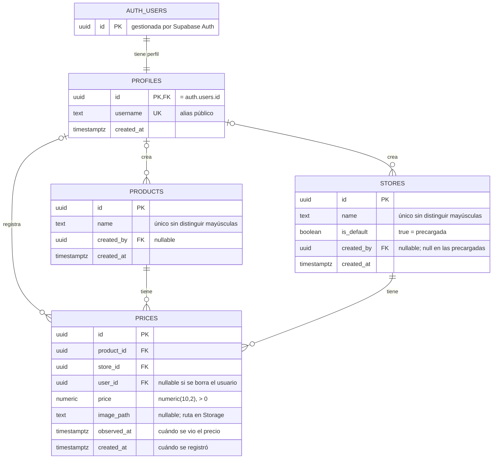

# Base de datos de CazaPrecios

> Estado: **borrador** — pendiente de revisión por el dueño del proyecto.
> Motor: PostgreSQL gestionado por Supabase.

## 1. Contexto

Hoy la app guarda los precios en el móvil con AsyncStorage: una clave por producto (`@prices_<nombre>`) que contiene una lista de `PriceEntry` (`store`, `price`, `imageUri`). Los datos no salen del dispositivo y el producto y la tienda son texto libre.

Objetivo de la base de datos: que los precios se guarden en la nube y sean **compartidos por la comunidad**, con historial, para poder responder preguntas como:

- ¿Qué tienda tiene el precio más barato de un producto?
- ¿Cómo ha evolucionado el precio de un producto en una tienda?
- ¿Qué supermercado sale más barato para una lista de productos?

## 2. Decisión: SQL (PostgreSQL) frente a NoSQL

**Opciones consideradas:** PostgreSQL (Supabase) y bases de documentos (Firestore, MongoDB).

**Decisión:** PostgreSQL con Supabase.

**Motivos:**

1. Los datos son relacionales: un precio une un producto, una tienda y un usuario.
2. Las consultas clave (más barato, evolución, comparativa por tienda) son `JOIN` + agregaciones, naturales en SQL y costosas en NoSQL (duplicar datos o calcular en el cliente).
3. Integridad garantizada por la base de datos: claves foráneas, `CHECK (price > 0)`, nombres únicos.
4. El esquema es estable; la flexibilidad de NoSQL aporta poco. Si hiciera falta, Postgres tiene `jsonb`.
5. Supabase añade autenticación, Row Level Security (RLS), Storage para fotos y API automática.

**Consecuencias:**

- Hay que diseñar el esquema y gestionar migraciones.
- La sincronización offline no viene incluida; si se quiere, se diseña aparte.

## 3. Decisiones de diseño

| Tema | Decisión |
|---|---|
| Propiedad de los datos | Precios **compartidos**: todos leen todo; cada precio registra qué usuario lo aportó. |
| Tiendas | **Tabla propia**. Las de `DEFAULT_STORES` van precargadas; la opción "Otro" crea una tienda nueva. |
| Historial | **Sí**. Cada precio es una observación con fecha; no hay unicidad producto+tienda. |
| Usuarios | Los gestiona Supabase Auth (`auth.users`). Los datos públicos del usuario van en `profiles`. |
| Fotos | En Supabase Storage; la tabla guarda solo la ruta del archivo. |
| Dinero | `numeric(10,2)`, nunca `float`. Moneda única: EUR. |
| Identificadores | `uuid` generados por la base de datos (`gen_random_uuid()`). |
| Fechas | `timestamptz` (con zona horaria). |

## 4. Modelo conceptual

- Un **usuario** registra cero o muchos **precios**.
- Un **producto** tiene cero o muchos **precios**.
- Una **tienda** tiene cero o muchos **precios**.
- Un **precio** pertenece a exactamente un producto y una tienda, y lo aportó un usuario.
- Un **usuario** puede crear productos y tiendas (queda registrado quién).

`prices` es la tabla central que une las demás.

## 5. Diagrama entidad-relación

## 6. Detalle de tablas

### `profiles`

| Columna | Tipo | Nulo | Defecto | Notas |
|---|---|---|---|---|
| `id` | `uuid` | no | — | PK y FK → `auth.users.id` `ON DELETE CASCADE` |
| `username` | `text` | no | — | Único |
| `created_at` | `timestamptz` | no | `now()` | |

Se crea automáticamente al registrarse un usuario (trigger sobre `auth.users`).

### `products`

| Columna | Tipo | Nulo | Defecto | Notas |
|---|---|---|---|---|
| `id` | `uuid` | no | `gen_random_uuid()` | PK |
| `name` | `text` | no | — | `CHECK` longitud > 0 |
| `created_by` | `uuid` | sí | — | FK → `profiles.id` `ON DELETE SET NULL` |
| `created_at` | `timestamptz` | no | `now()` | |

Índice único sobre el nombre normalizado (`lower(trim(name))`) para evitar "Leche" y "leche" duplicados.

### `stores`

| Columna | Tipo | Nulo | Defecto | Notas |
|---|---|---|---|---|
| `id` | `uuid` | no | `gen_random_uuid()` | PK |
| `name` | `text` | no | — | `CHECK` longitud > 0 |
| `is_default` | `boolean` | no | `false` | `true` para las de `DEFAULT_STORES` |
| `created_by` | `uuid` | sí | — | FK → `profiles.id` `ON DELETE SET NULL` |
| `created_at` | `timestamptz` | no | `now()` | |

Índice único sobre `lower(trim(name))`. Datos iniciales (seed): Mercadona, Carrefour, Consum, Lidl, Dia, Alcampo, Eroski.

### `prices`

| Columna | Tipo | Nulo | Defecto | Notas |
|---|---|---|---|---|
| `id` | `uuid` | no | `gen_random_uuid()` | PK |
| `product_id` | `uuid` | no | — | FK → `products.id` `ON DELETE RESTRICT` |
| `store_id` | `uuid` | no | — | FK → `stores.id` `ON DELETE RESTRICT` |
| `user_id` | `uuid` | sí | — | FK → `profiles.id` `ON DELETE SET NULL` |
| `price` | `numeric(10,2)` | no | — | `CHECK (price > 0)` |
| `image_path` | `text` | sí | — | Ruta dentro del bucket `price-images` |
| `observed_at` | `timestamptz` | no | `now()` | `CHECK (observed_at <= now())` |
| `created_at` | `timestamptz` | no | `now()` | |

Índices:

- `(product_id, observed_at DESC)`: historial y precio más reciente de un producto.
- `(store_id)`: precios de una tienda.
- `(user_id)`: aportaciones de un usuario.

**Por qué esas reglas de borrado:**

- `RESTRICT` en producto y tienda: no se puede borrar algo que tiene precios; protege el historial.
- `SET NULL` en usuario: si un usuario borra su cuenta, sus precios siguen siendo útiles para la comunidad.

## 7. Permisos (Row Level Security)

RLS activado en **todas** las tablas. Por defecto se deniega todo; solo se permite lo que aparece aquí. El `service_role` (backend, panel de Supabase) ignora RLS y se usa para administración.

`anon` = sin sesión · `authenticated` = usuario con sesión · `auth.uid()` = id del usuario actual.

| Tabla | Leer (`SELECT`) | Crear (`INSERT`) | Editar (`UPDATE`) | Borrar (`DELETE`) |
|---|---|---|---|---|
| `profiles` | `anon`, `authenticated` | Solo el trigger de registro | Propio (`id = auth.uid()`) | Nadie (se borra en cascada con la cuenta) |
| `products` | `anon`, `authenticated` | `authenticated`, con `created_by = auth.uid()` | Solo admin | Solo admin |
| `stores` | `anon`, `authenticated` | `authenticated`, con `created_by = auth.uid()` e `is_default = false` | Solo admin | Solo admin |
| `prices` | `anon`, `authenticated` | `authenticated`, con `user_id = auth.uid()` | Propio (`user_id = auth.uid()`) | Propio (`user_id = auth.uid()`) |

Notas:

- Productos y tiendas los usan todos, por eso un usuario no puede editarlos ni borrarlos aunque los haya creado: evitaría que alguien rompa datos ajenos.
- En `UPDATE` de `prices` hay que impedir que el usuario cambie `user_id` a otro (la condición se comprueba también sobre la fila nueva).

### Storage: bucket `price-images`

| Acción | Quién |
|---|---|
| Ver imágenes | Público |
| Subir | `authenticated`, solo en la carpeta `{auth.uid()}/` |
| Borrar | El dueño de la carpeta |

Límite propuesto: imágenes JPEG/PNG/WebP de hasta 2 MB.

## 8. Decisiones abiertas

- [ ] **Moderación**: ¿cómo se gestionan precios falsos o productos duplicados (reportes, votos, rol de moderador)?
- [ ] **Código de barras**: ¿añadir `products.barcode` (único, opcional) para identificar productos?
- [ ] **Datos de producto**: ¿categoría, marca, formato (1 L, 500 g) para comparar precio por unidad?
- [ ] **Ubicación de la tienda**: ¿"Mercadona" es una cadena o cada local es una tienda distinta?
- [ ] **Uso sin cuenta**: ¿se permite leer sin iniciar sesión (como propone la tabla de permisos)?
- [ ] **Migración**: ¿se suben a la nube los precios que los usuarios ya tienen en AsyncStorage?
- [ ] **Proyecto de Supabase**: lo crea el dueño del repositorio (cuenta, región, plan).
